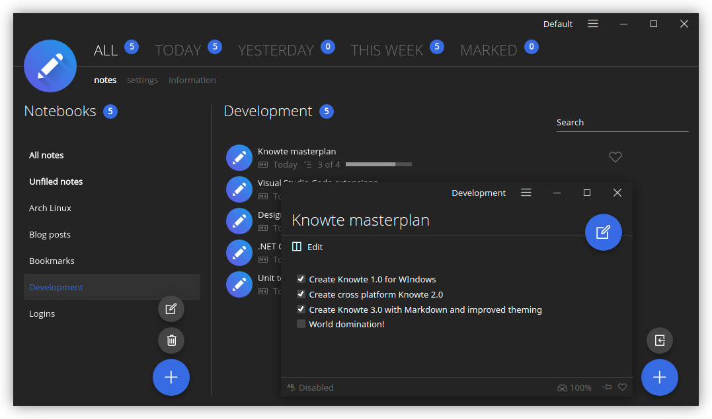
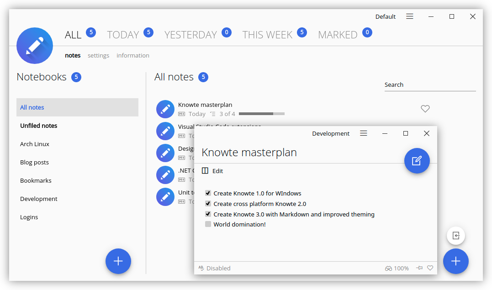

# Knowte

Knowte is a note taking application that allows you to quickly and easily organize and find your notes. This version is written using Electron, Angular and Typescript. The original Knowte (for Windows), which is written in WPF and C#, remains available <a href="https://github.com/digimezzo/knowte-windows">here</a>.

[](https://github.com/digimezzo/knowte/releases/latest)
[](https://github.com/digimezzo/knowte/issues)
[](https://www.paypal.com/cgi-bin/webscr?cmd=_s-xclick&hosted_button_id=MQALEWTEZ7HX8)

<a href='https://ko-fi.com/S6S11K63U' target='_blank'></a>

[](https://snapcraft.io/knowte)

## Screenshot





## Features

- Create classic rich-text notes or write notes in Markdown with a live preview and synchronized scrolling.
- Format Markdown with headings, emphasis, links, images, tables, quotes, task lists, and highlighted text.
- Colorize fenced code blocks in the preview. The editor provides language templates for Bash, C, C++, C#, CSS, Go, HTML, Java, JavaScript, JSON, Markdown, Mermaid, PowerShell, Python, Rust, SQL, TypeScript, VB.NET, Windows Batch, XML, and YAML.
- Render Mermaid diagrams directly from Markdown code blocks.
- Organize notes into collections and notebooks. Pin, mark, tag, archive, and move notes.
- Search note titles, contents, and tags, and create links between notes.
- Encrypt notes, use the built-in trash, and back up and restore collections.
- Import and export notes, and print notes or export them as PDF.
- Choose light or dark themes, adjust text size, and use spell checking.

## Performance diagnostics

To investigate delays, enable **Settings > Advanced > Diagnostics > Enable performance diagnostics** and restart Knowte.
Use **Open log folder** in the same section to find the log. Disable the setting and restart to stop the additional logging.
To compare note opening without the hidden spare window, disable **Settings > Advanced > Note window performance >
Preload note windows** and restart Knowte. Preloading is enabled by default; re-enable it and restart to restore it.

Note-opening entries include the note ID, process ID and timestamps. `NoteOpen.dispatch` records the request from the main
window; `[noteOpen]` entries record window selection, spare loading and the wait for it; and `NoteOpen.initialize` and its
individual stages record work in the note window. A `nextAnimationFrame` entry records a browser animation-frame callback,
not proof that the note has been painted or is responsive. Unlock timing may include time spent entering a password.
An operation with a start but no finish may still be running, or its window may have closed.

The log can contain note IDs, collection paths and other diagnostic information. Review it before sharing; these timing
entries do not include note contents. Background-window timer throttling or system sleep can also produce event-loop warnings.

## Build prerequisites

-   wine: required to build Windows package
-   rpm: required to build rpm package
-   libarchive-tools: contains bsdtar, which is required to build pacman package.

**To install the prerequisites on Ubuntu:**

sudo apt install wine rpm libarchive-tools

**To install the prerequisites on Arch Linux and Manjaro:**

sudo pacman -S wine rpm-tools

## Build instructions

```bash
$ git clone https://github.com/digimezzo/knowte.git
$ cd knowte
$ npm install            # Download dependencies
$ npm start              # Start Knowte
$ npm run electron:windows   # Build for Windows
$ npm run electron:linux     # Build for Linux
$ npm run electron:mac       # Build for Mac
```

## Pacman installation notes

The pacman package can be installed using this command (replace x.y.z with the correct version number):

`$ sudo pacman -U Knowte-x.y.z.pacman`

If you're getting an error concerning a missing package libappindicator-sharp, use this command to perform the installation instead (replace x.y.z with the correct version number):

`$ sudo pacman -U Knowte-x.y.z.pacman --assume-installed libappindicator-sharp`
