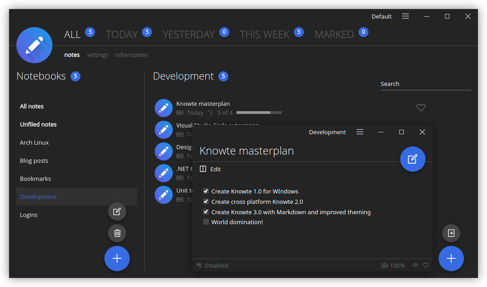
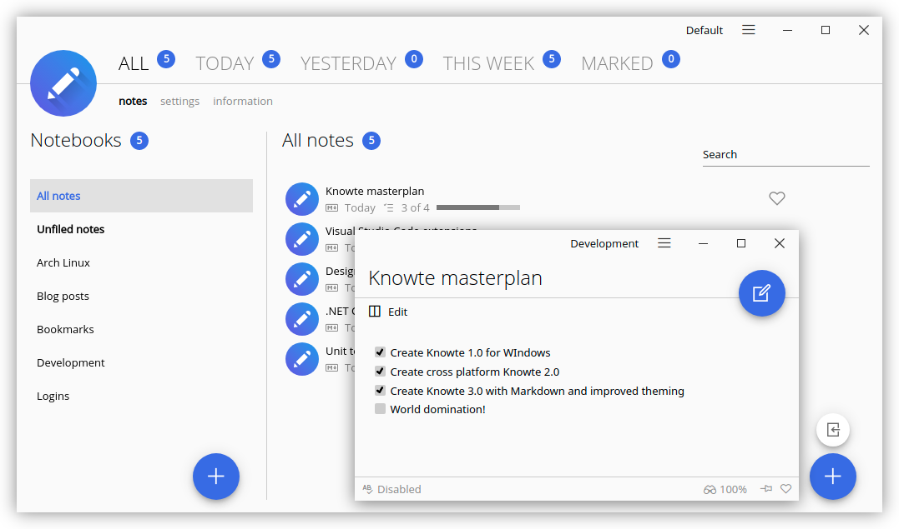

# Knowte

Knowte is a note taking application that allows you to quickly and easily organize and find your notes. This version is written using Electron, Angular and Typescript. The original Knowte (for Windows), which is written in WPF and C#, remains available <a href="https://github.com/digimezzo/knowte-windows">here</a>.

[](https://github.com/digimezzo/knowte/releases/latest)
[](https://github.com/digimezzo/knowte/issues)
[](https://www.paypal.com/cgi-bin/webscr?cmd=_s-xclick&hosted_button_id=MQALEWTEZ7HX8)

<a href='https://ko-fi.com/S6S11K63U' target='_blank'></a>

[](https://snapcraft.io/knowte)

## Screenshot





## Linking notes

In a Markdown note, choose **Link to note** in the editing toolbar, search by
title or notebook, and select a destination. Knowte inserts a standard Markdown
link such as `[Installation guide](knowte://note/AbC123)`.

Click the link in the preview to open the destination's note window, or focus it
if it is already open. Links can target Markdown or classic notes, including
encrypted notes (which still require unlocking). The picker excludes trashed
notes and shows the notebook name beneath each note title.
The picker supports searching the full collection and uses a scrolling list that
renders only nearby results to stay responsive with large collections.
Search is case-insensitive and matches each word anywhere in the title or
notebook name, in any order, like the main window's text search.

Links use stable note IDs, so renaming a note or moving it between notebooks does
not break navigation. Link labels are saved text and are not automatically renamed.
Links resolve only in the active collection; moving notes to another collection,
exporting them, or permanently deleting a target does not repair incoming links.
A missing or trashed target displays a message instead of opening a window.

These are in-app links, not operating-system protocol registrations. Backlinks
and `[[Wiki links]]` are not yet supported.

## Backup and restore

Keep your working collections on a local disk to avoid cloud-sync latency.
In **Settings > Advanced > Backup & restore**, select a separate backup folder
enable automatic backups, and choose
the interval (15 minutes to 3 hours) and number of backups to retain per collection
(1 to 20). Defaults are one hour and 5 backups. **Back up now** also works without
automatic backups enabled.
The destination and collections folder must not contain one another.

While Knowte is running, it backs up all saved collections, skipping unchanged
ones on scheduled checks. Each collection keeps a small, persistent revision
marker file (`.knowte-revision.json`) that is updated before any backed-up data
is written (note content, attachments, database metadata, renaming, importing,
moving, etc.). A scheduled check compares this marker against the revision it
last backed up; if they still match, the check skips the collection cheaply
(only confirming the previous archive still exists, without re-copying or
re-hashing its contents). Any difference, or a missing/unreadable marker,
triggers a full backup; an unreadable or malformed marker is also logged as a
warning and then regenerated. **Back up now** always performs a full backup,
regardless of the marker, so it remains a reliable way to force a fresh backup
or repair a damaged destination archive.

This marker-based check trusts that nothing touched the collection files
outside of Knowte since the last check: it does **not** detect changes made to
a collection while Knowte is closed (for example, restoring an older copy of
the collection folder, or edits made by another device sharing a synced
folder), and it does not re-verify an existing destination archive's integrity
on the fast path. Use **Back up now** if you suspect external changes or a
damaged backup.

An overdue check runs after startup or resume; failed
checks retry after five minutes. Keep Knowte open for scheduled backups.
Content in open notes is saved without closing them; title edits must finish
their normal autosave first. If a collection keeps changing,
Knowte reports an error and retries later rather than publishing an inconsistent
snapshot. Compression, checksum verification and destination I/O run in a
worker, not in the note editor. Disk contention is still possible.

Each `.knowtebackup` file is a complete ZIP archive
with a filename such as `Knowte-Work-20261018T064041Z.knowtebackup`
(ISO 8601 basic format, UTC, to the second). Each archive contains the collection
database, note content, attachments and a versioned checksum manifest. Incomplete
source collections are backed up as-is: missing note content files produce a
warning in the application log, without deleting notes or generating replacement
content. Restoring such a backup preserves the missing-file state and logs a
warning too. Files listed in the backup manifest must still pass checksum
verification. Incomplete copies have a `.partial` suffix and cannot be restored
through the file picker.
Old backups are removed only after a new, verified archive is published.
Success means the copy reached the selected folder. If you use a cloud-synced
folder, this does **not** mean uploading has finished. Check your sync
application's status before relying on cloud recovery. Backup archives are not password-protected; existing encrypted note
content and attachments stay encrypted.

Choose **Restore a backup** in settings or on the welcome screen. On a fresh
installation, select a local destination when prompted. Knowte verifies the
archive before publishing a new collection named `Original name (restored)`,
adding a number if needed. Existing collections are never merged or replaced.
Use the collection switcher to open the restored collection. Note IDs, internal
links, tags, notebooks and trash state are preserved. Passwords for encrypted
notes are still required. Preferences are not part of a collection backup.

## Build prerequisites

-   wine: required to build Windows package
-   rpm: required to build rpm package
-   libarchive-tools: contains bsdtar, which is required to build pacman package.

**To install the prerequisites on Ubuntu:**

sudo apt install wine rpm libarchive-tools

**To install the prerequisites on Arch Linux and Manjaro:**

sudo pacman -S wine rpm-tools

## Build instructions

```bash
$ git clone https://github.com/digimezzo/knowte.git
$ cd knowte
$ npm install            # Download dependencies
$ npm start              # Start Knowte
$ npm run electron:windows   # Build for Windows
$ npm run electron:linux     # Build for Linux
$ npm run electron:mac       # Build for Mac
```

## Pacman installation notes

The pacman package can be installed using this command (replace x.y.z with the correct version number):

`$ sudo pacman -U Knowte-x.y.z.pacman`

If you're getting an error concerning a missing package libappindicator-sharp, use this command to perform the installation instead (replace x.y.z with the correct version number):

`$ sudo pacman -U Knowte-x.y.z.pacman --assume-installed libappindicator-sharp`
